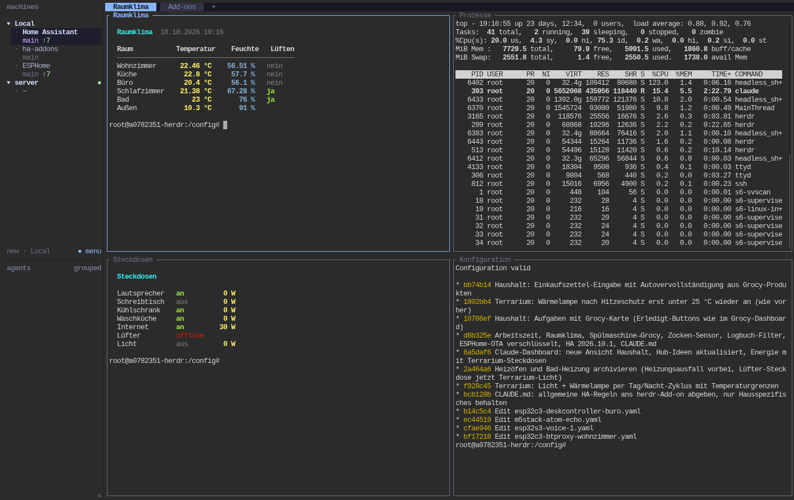

# Home-Assistant-Add-ons von Ottes

## herdr: Coding-Agents, die in Home Assistant wohnen

Claude Code und andere Agents laufen direkt in Home Assistant weiter, auch wenn
der Laptop zu ist. Sie kennen deine Konfiguration, prüfen sie, laden neu, flashen
ESPHome-Geräte und melden sich, wenn sie fertig sind.

- **Immer an:** Sitzungen überleben Verbindungsabbrüche und Neustarts
- **Überall erreichbar:** Seitenleiste in HA, SSH oder `herdr` vom eigenen Rechner
- **Kennt Home Assistant:** Werkzeuge, Skills und Regeln für Agents sind dabei
- **Erweiterbar:** Pakete aus Debian, npm und Python per Konfiguration

[Zum Add-on](herdr/) · [Dokumentation](herdr/DOCS.md) · [Änderungen](herdr/CHANGELOG.md)
